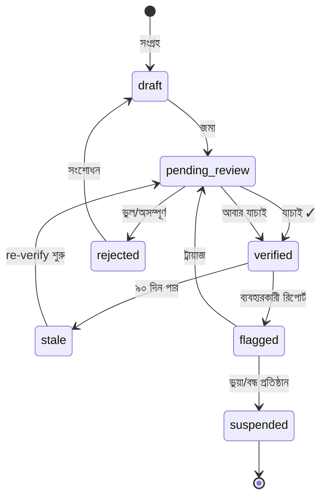
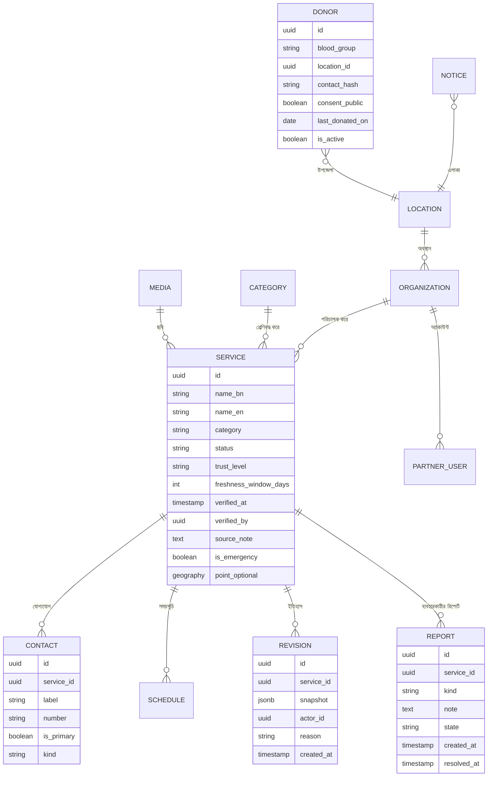

# SpCare — মাস্টার প্ল্যান

> **সংস্করণ:** 1.0 · **তারিখ:** ২০২৬-১০-২৫ · **অবস্থা:** অনুমোদনের অপেক্ষায় (M0 গেট)
> **নীতি:** কোড লেখার আগে সত্য, দায় ও রক্ষণাবেক্ষণ ঠিক। এই ডকুমেন্টই সেই চুক্তি।

---

## ১. দিক ও নীতি

**এক লাইনে:** শেরপুরের প্রতিটি প্রয়োজনীয় সেবার একটি যাচাই করা, হালনাগাদ, দুর্যোগ-সহনশীল ডিজিটাল ঠিকানা।

তিনটি অ-আলোচনীয় নীতি, যেগুলো ফিচারের চেয়ে উপরে:

1. **Trust before reach.** যাচাই ছাড়া কোনো এন্ট্রি প্রধান সারফেসে যাবে না। ব্যবহারকারীর সংখ্যা বাড়ানোর জন্য নির্ভুলতা কমবে না।
2. **Fresh over complete.** ৩০০টি হালনাগাদ এন্ট্রি ৩,০০০টি পুরোনো এন্ট্রির চেয়ে ভালো। প্রতিটি তথ্যের মেয়াদ আছে, মেয়াদ শেষে সেটি নিজে থেকে "পুরোনো" হয়ে যায়।
3. **Works when the network doesn't.** জরুরি প্যাক (হাসপাতাল, অ্যাম্বুলেন্স, থানা, ফায়ার) ডিভাইসে প্রি-লোড থাকে — ইন্টারনেট ছাড়াই খোলা যায়।

---

## ২. ব্যবহারকারী ও তাদের কাজ

### Personas

| Persona | প্রেক্ষাপট | সফলতা কী |
|---|---|---|
| **রফিক, ৩৪, দিনমজুর** | স্মার্টফোন কম চালায়, টাইপ করতে ধীর | ২ ট্যাপে নম্বর পায়, কল যায় |
| **সুমাইয়া, ২১, ছাত্রী** | রক্তদান গ্রুপে সক্রিয় | নিজের গ্রুপের ডোনার খুঁজে পায়, সম্মতি থাকে |
| **ডা. আনোয়ার, ৫২** | চেম্বার বদলায়, তথ্য পুরোনো হয়ে যায় | নিজেই প্রোফাইল আপডেট করতে পারে |
| **ভলান্টিয়ার রনি** | সপ্তাহে ২ ঘণ্টা দেয় | ২০টি এন্ট্রি ফোনে যাচাই করে ১ ঘণ্টায় |
| **অ্যাডমিন** | কনটেন্ট ও রিপোর্ট সামলায় | কী পুরোনো, কী রিপোর্টেড — এক স্ক্রিনে |
| **জেলা প্রশাসন** | অফিসিয়াল নোটিশ দিতে চায় | যাচাই করা উৎস হিসেবে পোস্ট করে |

### Jobs to be done

1. **জরুরি (০–৬০ সেকেন্ড):** "এখনই কারও সাথে কথা বলতে হবে।" → নম্বর, দিকনির্দেশ, অফলাইন।
2. **পরিকল্পিত (৫–৩০ মিনিট):** "কাল সকালে কোন ডাক্তার বসবেন?" → সময়সূচি, ফোন, ম্যাপ।
3. **অবদান (১–৫ মিনিট):** "এই তথ্যটা ভুল / আমি সাহায্য করতে চাই।" → রিপোর্ট, ডোনার রেজিস্ট্রেশন।
4. **আস্থা (১০ সেকেন্ড):** "এটা কি সত্যি?" → verified ব্যাজ, সূত্র, শেষ যাচাইয়ের তারিখ।

---

## ৩. স্কোপ

### MVP (Phase 1–3, ~৬ সপ্তাহ)

| # | মডিউল | ভেতরে কী |
|---|---|---|
| 1 | **জরুরি ডিরেক্টরি** | হাসপাতাল, অ্যাম্বুলেন্স, থানা, ফায়ার সার্ভিস, বিদ্যুৎ/পানি, ৯৯৯ ব্যাখ্যা |
| 2 | **রক্তদান** | গ্রুপ + উপজেলা ফিল্টার, সম্মতি-ভিত্তিক যোগাযোগ, শেষ রক্তদানের তারিখ |
| 3 | **সেবা ডিরেক্টরি** | ডাক্তার, ডায়াগনস্টিক, ফার্মেসি, সরকারি অফিস, আবাসন |
| 4 | **নোটিশ ও কমিউনিটি** | অফিসিয়াল নোটিশ, মডারেটেড পোস্ট, রিপোর্ট |
| 5 | **Admin + Partner** | CRUD, ভেরিফিকেশন কিউ, রিভিশন, অডিট লগ |
| 6 | **PWA + অফলাইন প্যাক** | ইনস্টলযোগ্য, জরুরি প্যাক, ব্যাকগ্রাউন্ড সিঙ্ক |

### v1.1 (Phase 4, পরের ৪ সপ্তাহ)

ম্যাপ ভিউ (PostGIS), দিকনির্দেশ, পুশ নোটিফিকেশন, বাংলা ট্রান্সলিটারেশন সার্চ, রেভিনিউ-নিরপেক্ষ "ভেরিফায়েড পার্টনার" ব্যাজ, CSV বাল্ক ইমপোর্ট, স্বয়ংক্রিয় re-verify রিমাইন্ডার।

### ইচ্ছাকৃতভাবে বাদ

ই-কমার্স, চ্যাট, ভিডিও, AI চ্যাটবট (v2-এর আগে নয়), মাল্টি-ডিস্ট্রিক্ট, নেটিভ অ্যাপ (PWA যথেষ্ট), রেটিং/রিভিউ (ভুয়া রিভিউয়ের ঝুঁকি)।

---

## ৪. তথ্যের বিশ্বাস মডেল

### ৪.১ উৎসের ক্রম (source hierarchy)

```
official (সরকারি/প্রাতিষ্ঠানিক লিখিত)  >  partner (প্রতিষ্ঠান নিজে)  >  community (ভলান্টিয়ার যাচাই)
```

উপরের স্তর নিচের স্তরকে ওভাররাইড করে, কিন্তু পুরোনো রেকর্ড ডিলিট হয় না — রিভিশন হিসেবে থাকে।

### ৪.২ এন্ট্রির জীবনচক্র



**নিয়ম:** `stale` এন্ট্রি পাবলিক সারফেসে থাকে, কিন্তু উপরে হলুদ "পুরোনো — শেষ যাচাই X দিন আগে" ব্যানার এবং ক্রমে নিচে নামে। `suspended` কখনো দেখায় না।

### ৪.৩ তাজাভাবের স্কোর

```
freshness_score = clamp(1 - age_days / review_window_days, 0, 1)
```

`review_window` ক্যাটাগরি অনুযায়ী: জরুরি সেবা **৯০ দিন**, স্বাস্থ্য **৯০**, ব্যবসা **১৮০**, পর্যটন **৩৬৫**।

---

## ৫. তথ্য স্থাপত্য (IA)

### পাবলিক স্ক্রিন

1. **হোম** — জরুরি বড় বাটন, সার্চ, ৫টি উপজেলার সিলেক্টর, "আজকের নোটিশ", আবহাওয়া/একিউআই কার্ড
2. **সার্চ ফলাফল** — ক্যাটাগরি চিপ, দূরত্ব, verified ফিল্টার, সাজানোর অপশন
3. **এন্ট্রি ডিটেইল** — ফোন (বড়), ম্যাপ, সময়সূচি, verified ব্যাজ + সূত্র + শেষ যাচাই, রিপোর্ট বাটন, "সেভ/অফলাইন"
4. **রক্তদান** — গ্রুপ গ্রিড, এলাকা ফিল্টার, সম্মতি-স্ট্যাটাস, অনুরোধ পোস্ট
5. **নোটিশ** — অফিসিয়াল/কমিউনিটি ট্যাব, সময়ানুক্রম, শেয়ার
6. **আমার** — সেভ করা, আমার রিপোর্ট, ভাষা/থিম, অ্যাপ ইনস্টল

### অ্যাডমিন স্ক্রিন

ড্যাশবোর্ড (কিউ কাউন্টার: pending, stale, flagged, report), সার্ভিস CRUD, ক্যাটাগরি, লোকেশন, নোটিশ, মিডিয়া, ভেরিফিকেশন কিউ, কমিউনিটি মডারেশন, ইউজার/রোল, অডিট লগ, সেটিংস।

---

## ৬. ডোমেইন মডেল (ERD)



**ডিজাইন সিদ্ধান্ত:**
- ফোন নম্বর `CONTACT`-এ আলাদা রো — একটাই এন্ট্রিতে একাধিক নম্বর (হাসপাতালের ইমার্জেন্সি, রিসেপশন, অ্যাম্বুলেন্স)।
- `REVISION`-এ সম্পূর্ণ JSON স্ন্যাপশট — যেকোনো সময় "কে কখন কী বদলেছে" প্রমাণযোগ্য।
- রক্তদাতার নম্বর এনক্রিপ্টেড/হ্যাশড; পাবলিক টেক্সটে কখনো সরাসরি বসে না, "কল করুন" ফ্লো দিয়ে রিলে হয় বা সম্মতি থাকলে দেখায়।
- `geography` ঐচ্ছিক (Phase 4-এ PostGIS), কিন্তু ফিল্ড এখন থেকেই থাকবে — পরে মাইগ্রেশন যন্ত্রণা এড়াতে।

---

## ৭. API কনট্র্যাক্ট

**শৈলী:** REST + OpenAPI 3.1 (tRPC নয় — ভবিষ্যতের মোবাইল/পার্টনার ইন্টিগ্রেশনের জন্য ভাষা-নিরপেক্ষ চুক্তি দরকার)।

```text
GET    /api/v1/services?category=&upazila=&q=&verified=&sort=&cursor=
GET    /api/v1/services/{id}
GET    /api/v1/services/{id}/revisions        (admin)
POST   /api/v1/services                        (admin)
PATCH  /api/v1/services/{id}                   (admin/partner)
POST   /api/v1/services/{id}/verify            (admin)
POST   /api/v1/services/{id}/report            (public, rate-limited)
GET    /api/v1/emergency-pack?upazila=          (offline payload, ETag)
GET    /api/v1/notices?state=published
GET    /api/v1/donors?blood_group=&upazila=     (consent-filtered)
POST   /api/v1/donors                           (registration)
GET    /api/v1/search/suggest?q=                (typeahead)
GET    /api/v1/health
```

### রেসপন্স খাম (envelope)

```json
{
  "data": {},
  "meta": { "request_id": "…", "cursor": "…", "cached": false },
  "error": null
}
```

**নিয়ম:** সব লিস্ট কার্সর-পেজিনেটেড (offset নয় — ডেটা বদলালে পেজ লাফায়)। সব মিউটেশন `Idempotency-Key` নেয়। প্রতিটা এররে মেশিন-পাঠ্য `code` + বাংলা `message`। `request_id` লগে থাকে।

**ক্যাশিং:** পাবলিক GET-এ `ETag` + `Cache-Control: public, max-age=60, stale-while-revalidate=300`। ভেরিফাই/পাবলিশে ট্যাগ-ভিত্তিক ইনভ্যালিডেশন।

---

## ৮. সার্চ

বাংলা সার্চ এই অ্যাপের প্রাণ। তিন স্তর:

1. **Normalization:** Unicode NFC, যুক্তাক্ষর-বানান ভ্যারিয়েন্ট, "ি/ী", "ু/ূ" নরমালাইজেশন, ইংরেজি বানান থেকে ট্রান্সলিটারেশন (`hospital` ⇄ `হাসপাতাল`).
2. **Index:** PostgreSQL `tsvector` (বাংলা স্টেমিং সীমিত) + `pg_trgm` fuzzy + কাস্টম synonym টেবিল (`ambulance`, `অ্যাম্বুলেন্স`, `এ্যাম্বুলেন্স`).
3. **Ranking:**

```
score = 0.40·text_match
      + 0.25·freshness_score
      + 0.15·trust_weight          (official 1.0 / partner 0.8 / community 0.6)
      + 0.10·distance_score        (যদি লোকেশন থাকে)
      + 0.10·usage_prior           (৭ দিনের কল/ভিউ, লগ-স্কেল)
```

**Fallback:** ইনডেক্সে কিছু না মিললে fuzzy ট্রাইগ্রাম, তারপর "আপনি কি এইগুলো খুঁজছেন?" + ক্যাটাগরি ব্রাউজ। শূন্য ফলাফল কখনোই ডেড-এন্ড নয়।

---

## ৯. অফলাইন ও PWA

| স্তর | কৌশল |
|---|---|
| App shell | Service worker precache, versioned, instant rollback |
| জরুরি প্যাক | প্রতিদিন একবার সিঙ্ক, `ETag`-ভিত্তিক, < 2MB gzip, ডিভাইসে IndexedDB |
| সাধারণ পেজ | Stale-while-revalidate, ৫ মিনিট |
| ছবি | Cache-first, ৩০ দিন, LRU ৫০MB |
| ডোনার/নোটিশ | Network-first, ব্যর্থ হলে শেষ সফল স্ন্যাপশট + "পুরোনো" ব্যানার |

**নিয়ম:** অফলাইনে যা দেখাচ্ছে তার বয়স সবসময় দেখাও। ইমার্জেন্সি প্যাকে "সর্বশেষ আপডেট: তারিখ" বাধ্যতামূলক।

---

## ১০. নোটিফিকেশন

- **Web Push** (VAPID) — শুধু ব্যবহারকারী অপ্ট-ইন করলে
- ট্রিগার: (১) জরুরি নোটিশ (২) আপনার সেভ করা এন্ট্রি বদলেছে (৩) আপনার রিপোর্টের স্ট্যাটাস বদলেছে (৪) ৯০ দিনে re-verify হয়েছে
- **কখনোই** মার্কেটিং পুশ নয়। ফ্রিকোয়েন্সি ক্যাপ: দিনে সর্বোচ্চ ১টি নন-এমার্জেন্সি।

---

## ১১. অ্যাডমিন ও RBAC

| রোল | সার্ভিস দেখে | এডিট | ভেরিফাই | পাবলিশ | ইউজার/রোল | অডিট |
|---|---|---|---|---|---|---|
| viewer | ✓ | – | – | – | – | – |
| editor | ✓ | ✓ (draft) | – | – | – | – |
| verifier | ✓ | ✓ | ✓ | – | – | – |
| publisher | ✓ | ✓ | – | ✓ | – | – |
| admin | ✓ | ✓ | ✓ | ✓ | ✓ | ✓ |
| partner | নিজের প্রতিষ্ঠান | ✓ (নিজের) | – | – | – | নিজের |

**নিয়ম:** high-risk অ্যাকশন (suspend, bulk publish, role change) = নিশ্চিতকরণ + কারণ + অডিট ইভেন্ট। নিজের রোল বদলানো যায় না।

---

## ১২. নিরাপত্তা ও হুমকি মডেল

| হুমকি | প্রভাব | প্রশমন |
|---|---|---|
| ভুয়া এন্ট্রি / স্ক্যাম নম্বর | ব্যবহারকারীর ক্ষতি, আস্থা নষ্ট | ভেরিফিকেশন বাধ্যতামূলক, রিপোর্ট কিউ, কল-ব্যাক যাচাই |
| ডেটা স্ক্র্যাপিং (ডোনার নম্বর) | প্রাইভেসি লঙ্ঘন | রেট লিমিট, consent-gated API, নম্বর হ্যাশড, Turnstile |
| অ্যাডমিন অ্যাকাউন্ট দখল | সম্পূর্ণ নিয়ন্ত্রণ | MFA বাধ্যতামূলক, সেশন ৮ ঘণ্টা, IP/ডিভাইস লগ, অডিট |
| স্প্যাম/গুজব পোস্ট | বিভ্রান্তি | pre-moderation (অফিসিয়াল বাদে), লিংক স্ক্যান, নতুন অ্যাকাউন্ট কোটা |
| DoS / বট ট্রাফিক | ডাউন | CF WAF + rate limit + ক্যাশ |
| সাপ্লাই চেইন | কোড এক্সিকিউশন | lockfile, `npm audit` গেট, pinned base image, SBOM |
| ব্যাকআপ হারানো | ডেটা ক্ষতি | দৈনিক dump + সাপ্তাহিক restore ড্রিল (RPO ২৪ঘ, RTO ৪ঘ) |

**গোপনীয়তা:** PII আলাদা স্কিমা/টেবিলে, অ্যাপ লগে কখনো ফোন নম্বর থাকে না (শুধু হ্যাশ), অডিট লগ ১২ মাস, ব্যবহারকারীর ডেটা এক্সপোর্ট/ডিলিট অনুরোধ ৩০ দিনে।

---

## ১৩. অপারেশন ও খরচ

| আইটেম | সিদ্ধান্ত | মাসিক খরচ |
|---|---|---|
| হোস্টিং | নিজের বক্স / VPS (Docker compose) | ০–$৬ |
| ডেটাবেস | PostgreSQL 16 + PostGIS | ০ (একই বক্স) |
| CDN/WAF | Cloudflare free | ০ |
| মিডিয়া | Cloudflare R2 (free tier) বা MinIO | ০ |
| মনিটরিং | Uptime Kuma + Sentry self-host | ০ |
| অ্যানালিটিক্স | Plausible self-host (cookie-less) | ০ |
| ডোমেইন | `spcare.<existing>` সাবডোমেইন | ০ |
| **মোট** | | **≈ ০–৬ USD** |

**ব্যাকআপ:** প্রতিদিন ০৩:০০ UTC-তে `pg_dump` → age-encrypted → R2 + লোকাল কপি; মাসে একবার restore ড্রিল, ফলাফল `PROGRESS`-এ।

**মেট্রিক:** p95 API < ৩০০ms, LCP < ২.৫s (4G), availability ৯৯.৫%, error rate < ০.৫%।

---

## ১৪. KPI বৃক্ষ

```
North Star: প্রতি সপ্তাহে "সফল সংযোগ" (কল ক্লিক, দিকনির্দেশ, নম্বর কপি)
├── Reach:    MAU · নতুন ব্যবহারকারী · ইনস্টল সংখ্যা
├── Quality:  verified % · freshness % · report→fix সময় · ভুলের হার
├── Depth:    প্রতি সেশনে সংযোগ · সেভ করা · ফেরত আসার হার (D7/D30)
└── Supply:   মোট এন্ট্রি · সক্রিয় পার্টনার · ভলান্টিয়ার ঘণ্টা
```

লক্ষ্য (৬ মাস): সংযোগ/সপ্তাহ ৩,০০০ · D30 রিটেনশন ২৫% · verified ৯০%+ · report→fix median ২৪ঘ।

---

## ১৫. ঝুঁকি নিবন্ধ

| # | ঝুঁকি | সম্ভাবনা | প্রভাব | প্রশমন |
|---|---|---|---|---|
| R1 | ডেটা পুরোনো হয়ে যাওয়া | উচ্চ | উচ্চ | ৯০-দিনের মেয়াদ, স্বয়ংক্রিয় রিমাইন্ডার, পার্টনার পোর্টাল |
| R2 | প্রথম ৩ মাসে ব্যবহারকারী না পাওয়া | মধ্যম | উচ্চ | ৫টি উপজেলায় ৫ জন "চ্যাম্পিয়ন", F-Commerce নয় বরং স্কুল/হাসপাতাল/মসজিদ-কমিউনিটি |
| R3 | ভুল জরুরি নম্বর → বিপদ | নিম্ন | খুব উচ্চ | দ্বি-স্তর যাচাই + "যাচাই হয়নি" ব্যাজ কখনো লুকানো না |
| R4 | ভলান্টিয়ার ঝরে পড়া | উচ্চ | মধ্যম | ২ ঘণ্টা/সপ্তাহের ছোট ব্যাচ, গেমিফায়েড কাউন্টার, স্বীকৃতি |
| R5 | প্রাইভেসি অভিযোগ | নিম্ন | উচ্চ | consent-first ডিজাইন, সহজ টেকডাউন (৪৮ঘ) |
| R6 | একজনের উপর নির্ভরতা (bus factor) | উচ্চ | উচ্চ | রানবুক + ADR + ব্যাকআপ + দ্বিতীয় অ্যাডমিন |
| R7 | স্কোপ ফুলে যাওয়া | উচ্চ | মধ্যম | Non-goals লিখিত, প্রতিটি নতুন ফিচার রোডম্যাপে ঢুকতে বাদ দিতে হয় কিছু |

---

## ১৬. রোলআউট (কীভাবে প্রথম ১,০০০ জন)

1. **সিড:** ৫ উপজেলার ৫ জন পরিচিত ভলান্টিয়ার, ২ সপ্তাহে ৩০০ এন্ট্রি।
2. **অ্যাঙ্কর:** ৩টি হাসপাতাল + ২টি ডায়াগনস্টিককে পার্টনার অ্যাকাউন্ট, নিজেরাই আপডেট করবে।
3. **লঞ্চ:** ফেসবুক লাইভ + স্থানীয় প্রেস + জেলা প্রশাসনের নোটিশ শেয়ার।
4. **লুপ:** প্রতিটি ভুল রিপোর্ট → ৪৮ ঘণ্টায় ফিক্স → "আপনার রিপোর্টে ঠিক হয়েছে" পুশ (লয়ালটি তৈরি হয়)।

---

## ১৭. সংজ্ঞা — "শেষ" কখন

v1 সম্পূর্ণ যখন:
- ৩০০ যাচাই করা এন্ট্রি, ৫ উপজেলা কভার
- জরুরি প্যাক অফলাইনে খোলে (প্লেন মোডে টেস্টেড)
- অ্যাডমিন কিউ শূন্য-ব্যাকলগে চলছে ৭ দিন
- ব্যাকআপ restore ড্রিল একবার সফল
- p95 < ৩০০ms, Lighthouse PWA ≥ ৯০
- প্রাইভেসি নোটিশ ও consent ফ্লো লাইভ
