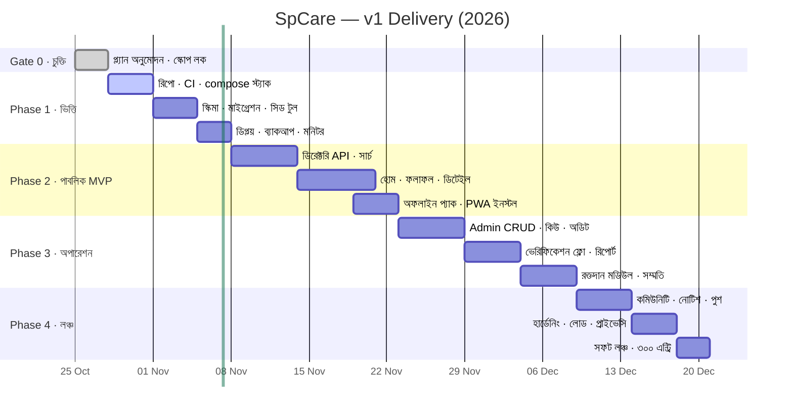
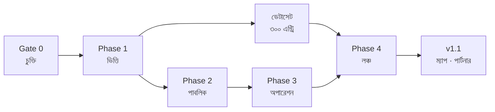

# SpCare — ডেলিভারি রোডম্যাপ

> **ভিত্তি:** [`01-PLAN.md`](01-PLAN.md) · **শুরু:** ২০২৬-১০-২৮ · **v1 লঞ্চ লক্ষ্য:** ২০২৬-১২-১৮
> এই রোডম্যাপের প্রতিটি ধাপের শেষে একটি **গেট** আছে। গেট পাস না হলে পরের ধাপ শুরু হয় না — এটাই এই ডকুমেন্টের একমাত্র কঠোর নিয়ম।

---

## ১. উত্তর তারা (North Star)

> **প্রতি সপ্তাহে "সফল সংযোগ"** — একজন মানুষ অ্যাপ থেকে কল করে, নম্বর পায় বা দিকনির্দেশ পায়, এবং সেটি সঠিক ছিল।

কোনো ফিচার এই সংখ্যা বাড়ায় না — সেটি এই রোডম্যাপে ঢোকে না।

---

## ২. ডেলিভারির নিয়ম

1. **এক সপ্তাহ = এক ডেমোযোগ্য জিনিস।** প্রতি শুক্রবার যা তৈরি, সেটা লাইভ URL-এ দেখা যায়।
2. **ডেটা আগে, UI পরে।** স্ক্রিন বানানোর আগে তার পেছনের এন্ট্রি থাকতে হবে।
3. **যা মাপা যায় না, তা শেষ হয় না।** প্রতিটি ধাপে সংখ্যা-ভিত্তিক exit criteria।
4. **স্কোপ বাড়াতে হলে কিছু বাদ দিতে হবে।** রোডম্যাপে কিছু যোগ করলে সমান আকারের কিছু সরবে — নাহলে তারিখ পিছিয়ে যায়।
5. **প্রতি ধাপের শেষে `PROGRESS` আপডেট** — কী হলো, কী বাকি, কী ভাঙল।

---

## ৩. টাইমলাইন

---

## ৪. ধাপে ধাপে

### 🟢 Gate 0 — চুক্তি (৩ দিন)

| কাজ | আউটপুট |
|---|---|
| প্ল্যান ও ADR অনুমোদন | এই রিপোতে হ্যাঁ-টিক |
| স্কোপ লক | `01-PLAN.md` §৩-এ যা আছে, তার বাইরে কিছু নয় |
| নাম/ব্র্যান্ড চূড়ান্ত | `SpCare` বা বাংলা নাম |
| হোস্টিং সিদ্ধান্ত | সাবডোমেইন + বক্স |

**Exit:** Product owner-এর লিখিত সম্মতি। এই গেট ছাড়া এক লাইন কোডও নয়।

---

### 🟩 Phase 1 — ভিত্তি (২ সপ্তাহ)

**লক্ষ্য:** খালি অ্যাপ নয় — **খালি অ্যাপ + সত্যিকারের ৩০টি এন্ট্রি** লাইভ।

| ডেলিভারেবল | মানদণ্ড |
|---|---|
| রিপো + CI | `main`-এ পুশ = টাইপচেক + টেস্ট + মাইগ্রেশন ড্রাই, সবুজ |
| ডেটাবেস | স্কিমা §৬ অনুযায়ী, `verified_at/verified_by/source` বাধ্যতামূলক |
| ইমপোর্ট টুল | CSV → ভ্যালিডেশন → draft এন্ট্রি (ভুল লাইন রিপোর্ট করে) |
| ডিপ্লয় | `spcare.<domain>` HTTPS, `/health` সবুজ, p95 < ৫০০ms (খালি) |
| ব্যাকআপ | দৈনিক dump + **একবার restore ড্রিল সফল** |
| মনিটর | Uptime alert → টেলিগ্রাম |

**গেট:** লাইভ URL-এ ৩০টি এন্ট্রি দেখা যায়, একটি রিসেট-ড্রিলে ডেটা ফিরে আসে।

---

### 🟦 Phase 2 — পাবলিক MVP (২ সপ্তাহ)

**লক্ষ্য:** একজন মানুষ ফোন বের করে ২০ সেকেন্ডে নম্বর পায় — ইন্টারনেট ছাড়াও।

| ডেলিভারেবল | মানদণ্ড |
|---|---|
| সার্চ ও ফিল্টার | বাংলা/ইংরেজি মিশ্র কুয়েরি কাজ করে (`হাসপাতাল`, `hospital`, ভুল বানান) |
| এন্ট্রি ডিটেইল | ট্যাপ-টু-কল, verified ব্যাজ, শেষ যাচাই, রিপোর্ট |
| অফলাইন প্যাক | প্লেন মোডে খোলে, < 2MB, "সর্বশেষ আপডেট" দেখায় |
| PWA | ইনস্টল প্রম্পট, Lighthouse ≥ ৯০, A2HS iOS-এও |
| অ্যাক্সেসিবিলিটি | কীবোর্ড নেভিগেশন, কনট্রাস্ট AA, স্ক্রিন রিডার লেবেল |

**গেট:** ৫ জন অপরিচিত ব্যবহারকারীকে ফোন ধরিয়ে দিয়ে ৩টি কাজ করানো — প্রত্যেকে ৩০ সেকেন্ডে নম্বর পায়। (মডারেটেড ইউজেবিলিটি টেস্ট)

---

### 🟨 Phase 3 — অপারেশন (২ সপ্তাহ)

**লক্ষ্য:** সিস্টেমকে জীবন্ত রাখার যন্ত্র — কিউ, ভেরিফিকেশন, রিপোর্ট।

| ডেলিভারেবল | মানদণ্ড |
|---|---|
| অ্যাডমিন | RBAC ম্যাট্রিক্স অনুযায়ী; প্রতিটি মিউটেশন অডিটে যায় |
| ভেরিফিকেশন কিউ | pending → verified/rejected, কারণ বাধ্যতামূলক |
| রিপোর্ট ফ্লো | ব্যবহারকারী রিপোর্ট → ট্রায়াজ → fix → রিপোর্টারকে জানানো |
| রক্তদান | consent ছাড়া কোনো নম্বর API-তে যায় না (টেস্টে প্রমাণিত) |
| Stale ইঞ্জিন | ৯০ দিনে স্বয়ংক্রিয় stale + কিউতে ঢোকা |

**গেট:** এডিটর → ভেরিফায়ার → পাবলিশার তিনজনের ফ্লো এক বসায় সম্পন্ন; অডিট লগে তিনজনের নাম।

---

### 🟥 Phase 4 — লঞ্চ (২ সপ্তাহ)

**লক্ষ্য:** ৩০০ এন্ট্রি, ৫ উপজেলা, কমিউনিটি, আর দুর্যোগে টিকে থাকা।

| ডেলিভারেবল | মানদণ্ড |
|---|---|
| নোটিশ + কমিউনিটি | pre-moderation, স্প্যাম কোট, রিপোর্ট |
| পুশ | অপ্ট-ইন, দিনে সর্বোচ্চ ১টি নন-এমার্জেন্সি |
| হার্ডেনিং | rate limit, WAF, MFA, SBOM, ডিপেন্ডেন্সি অডিট |
| লোড টেস্ট | ২০০ concurrent-এ p95 < ৮০০ms |
| প্রাইভেসি | নোটিশ লাইভ, ডিলিট/এক্সপোর্ট অনুরোধ ফ্লো |
| রানবুক | অন্য একজন অ্যাডমিন শুধু রানবুক পড়ে সাইট চালাতে পারে |

**গেট:** সফট লঞ্চ — ৩০০ verified এন্ট্রি, ৫ উপজেলা কভারেজ ১০০% জরুরি ক্যাটাগরিতে, শূন্য ক্রিটিক্যাল বাগ ৭২ ঘণ্টা।

---

## ৫. মাইলস্টোন ও exit criteria

| মাইলস্টোন | কী বোঝায় | exit criteria |
|---|---|---|
| **M0** | চুক্তি | প্ল্যান অনুমোদিত, স্কোপ লক |
| **M1** | ভিত্তি | ডিপ্লয় + ব্যাকআপ ড্রিল + ৩০ এন্ট্রি |
| **M2** | পাবলিক | ৩০ সেকেন্ডে নম্বর, অফলাইনে চলে |
| **M3** | অপারেশন | ৩-রোল ফ্লো + অডিট + consent-প্রুফ |
| **M4** | লঞ্চ | ৩০০ এন্ট্রি, হার্ডেনিং, রানবুক |
| **M5** | v1.1 | ম্যাপ, ট্রান্সলিটারেশন সার্চ, পার্টনার পোর্টাল |

---

## ৬. নির্ভরতা (কী কীসের পরে)

**সমান্তরাল পথ:** ডেটাসেট সংগ্রহের কাজ Phase 1 থেকেই চলবে, কোডের জন্য অপেক্ষা করবে না — এটাই লঞ্চের আসল ক্রিটিক্যাল পাথ।

---

## ৭. কে কী করবে (RACI)

| কাজ | Product Owner | Engineer | Data Lead | Verifier |
|---|---|---|---|---|
| স্কোপ ও প্রায়োরিটি | **A/R** | C | C | I |
| আর্কিটেকচার | A | **R** | I | I |
| সিভিক ডেটাসেট | A | C | **R** | **R** |
| যাচাই SOP | A | I | **R** | **R** |
| লঞ্চ ক্যাম্পেইন | **R** | I | C | C |
| প্রাইভেসি নোটিশ | **A** | C | C | I |

`A` = accountable · `R` = responsible · `C` = consulted · `I` = informed

---

## ৮. প্রতিটি রিলিজের চেকলিস্ট

- [ ] `main` সবুজ: টাইপচেক, টেস্ট, বিল্ড
- [ ] মাইগ্রেশন ফরোয়ার্ড-অনলি, রোলব্যাক প্ল্যান লেখা
- [ ] নতুন এন্ডপয়েন্টে রেট লিমিট + অথরাইজেশন টেস্ট
- [ ] PII লগে যাচ্ছে না (ফোন নম্বরে grep করে দেখানো)
- [ ] অফলাইন প্যাক নতুন করে জেনারেট হয়েছে
- [ ] p95 ও LCP আগের রিলিজের চেয়ে খারাপ নয়
- [ ] `PROGRESS.md` আপডেটেড (কী হলো, কী বাকি, কী ভাঙল)
- [ ] ব্যাকআপ আজকের তারিখের, restore টেস্ট করা

---

## ৯. সমাপ্তির সংজ্ঞা (Definition of Done)

একটি কাজ "শেষ" তখনই যখন:

1. কোড + টেস্ট + মাইগ্রেশন একসাথে আছে
2. খালি / লোডিং / এরর / অফলাইন — চারটি স্টেটই দেখা যায়
3. মোবাইল (৩৬০px) ও ডেস্কটপে যাচাই করা
4. বাংলা টেক্সটে কোনো `???` বা ভাঙা গ্লিফ নেই
5. অ্যাক্সেসিবিলিটি: কীবোর্ডে পুরো ফ্লো চলে
6. ডেটার সত্যতা যাচাই করা — ডেমো ডেটা লাইভে যায়নি

---

## ১০. ঝুঁকি → কোন ধাপে দেখা দেবে

| ঝুঁকি | কোথায় টের পাব | আগাম ব্যবস্থা |
|---|---|---|
| ডেটা পুরোনো | Phase 3-এ কিউ বাড়তে থাকলে | stale ইঞ্জিন Phase 2-তেই |
| ভলান্টিয়ার কমে যাওয়া | Phase 1-এর দ্বিতীয় সপ্তাহে | ৫ জন চ্যাম্পিয়ন, ২ ঘণ্টার ব্যাচ |
| স্কোপ ফুলে যাওয়া | প্রতিটি স্প্রিন্ট প্ল্যানিংয়ে | Non-goals লিস্ট সামনে রাখা |
| প্রাইভেসি গ্যাপ | Phase 3-এর consent টেস্টে | Phase 1-এই ডেটা ক্লাসিফিকেশন |
| একজনের উপর নির্ভরতা | যেকোনো ছুটিতে | রানবুক Phase 4-এর আগেই |
