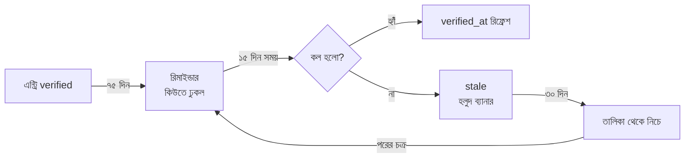

# ডেটা অপারেশন — শেরপুর ডেটাসেট

> **এই ডকুমেন্টটাই প্রকল্পের আসল কাজ।** অ্যাপ না থাকলেও এই কাজ হয়; এই কাজ না হলে অ্যাপের কোনো মূল্য নেই।

---

## ১. কেন এটাই কঠিন অংশ

কোড একবার লিখলে শেষ। কিন্তু "ডা. আনোয়ার স্যার এখনো শুক্র-শনিবার ৫টা-৯টা বসেন" — এই এক লাইন সত্য রাখতে প্রতি ৯০ দিনে ফোন করতে হবে। **প্ল্যাটফর্মের ৮০% খরচ ও শ্রম এখানে, ইন্টারফেসে নয়।**

তাই এই ডকুমেন্টে লেখা আছে: কী সংগ্রহ করব, কোথা থেকে, কে করবে, কীভাবে যাচাই করবে, আর কখন পুরোনো বলে চিহ্নিত হবে।

---

## ২. ডেটাসেট ইনভেন্টরি (v1 লক্ষ্য: ৩০০ এন্ট্রি)

| # | ক্যাটাগরি | এন্ট্রি (লক্ষ্য) | মেয়াদ | অগ্রাধিকার |
|---|---|---:|---:|---|
| 1 | হাসপাতাল ও ক্লিনিক | ৩৫ | ৯০ দিন | 🔴 P0 |
| 2 | অ্যাম্বুলেন্স / পরিবহন | ২৫ | ৯০ দিন | 🔴 P0 |
| 3 | থানা / ফায়ার / জরুরি | ২০ | ১৮০ দিন | 🔴 P0 |
| 4 | বিদ্যুৎ / পানি / গ্যাস | ১৫ | ১৮০ দিন | 🔴 P0 |
| 5 | ডাক্তার (চেম্বার) | ৭০ | ৯০ দিন | 🟠 P1 |
| 6 | ডায়াগনস্টিক / ল্যাব | ২৫ | ৯০ দিন | 🟠 P1 |
| 7 | ফার্মেসি | ৩০ | ১৮০ দিন | 🟠 P1 |
| 8 | সরকারি অফিস | ২৫ | ৩৬৫ দিন | 🟡 P2 |
| 9 | পর্যটন / আবাসন | ২০ | ৩৬৫ দিন | 🟡 P2 |
| 10 | রক্তদাতা (স্বেচ্ছাসেবী) | ৫০+ | অন-ডিমান্ড | 🟠 P1 |
| **মোট** | | **≈ ৩১৫** | | |

### উপজেলা বণ্টন

| উপজেলা | এন্ট্রি লক্ষ্য |
|---|---:|
| শেরপুর সদর | ১১০ |
| নালিতাবাড়ী | ৬০ |
| নকলা | ৫৫ |
| শ্রীবরদী | ৫০ |
| ঝিনাইগাতী | ৪৫ |

> প্রথম দুই সপ্তাহে **সদর ১০০%**, বাকিগুলো ৬০% — তারপর সমান করা। সদর আগে কারণ সেখানেই সবচেয়ে বেশি জরুরি সেবা কেন্দ্রীভূত।

---

## ৩. উৎসের ক্রম

| স্তর | উৎস | ব্যবহার |
|---|---|---|
| **A. Official** | জেলা প্রশাসনের ওয়েবসাইট/নোটিশ, স্বাস্থ্য অধিদপ্তর (DGHS), ফায়ার সার্ভিস, পুলিশের অফিসিয়াল তালিকা | সরাসরি `official` ট্যাগ, তবু ফোনে একবার নিশ্চিত করা |
| **B. Institutional** | হাসপাতাল/ডায়াগনস্টিকের নিজের সাইনবোর্ড, ভিজিটিং কার্ড, অফিসিয়াল ফেসবুক পেজ | `partner`/`official` |
| **C. Community** | স্থানীয় ভলান্টিয়ার, পরিবহন চালক সমিতি, ফার্মেসি সমিতি | `community`, ফোনে যাচাই বাধ্যতামূলক |
| **D. Never** | ফেসবুক কমেন্ট, হোয়াটসঅ্যাপ ফরওয়ার্ড, পুরোনো ডিরেক্টরি অ্যাপ | শুধু "সূত্র" হিসেবে — সরাসরি এন্ট্রি নয় |

**নিয়ম:** কোনো এন্ট্রি শুধু "ফেসবুকে দেখেছি" ভিত্তিতে তৈরি হবে না। প্রতিটির পেছনে ফোন কল, অফিসিয়াল ডকুমেন্ট, বা প্রতিষ্ঠানের নিজের হাতে লেখা তথ্য থাকবে।

---

## ৪. যাচাইয়ের SOP (ভলান্টিয়ারের জন্য)

### ধাপ ১ — সংগ্রহ (৫ মিনিট/এন্ট্রি)

CSV টেমপ্লেটে ভরো:

```csv
name_bn,name_en,category,upazila,address,phone_primary,phone_alt,hours,source_type,source_note
শেরপুর সদর হাসপাতাল,Sherpur Sadar Hospital,hospital,সদর,কলেজ রোড,০৯২১-XXXXXX,,২৪ ঘণ্টা,official,জেলা প্রশাসন ওয়েবসাইট ২০২৬-১০
```

### ধাপ ২ — কল (৩ মিনিট/এন্ট্রি)

**ফোনে ঠিক এই কথাগুলো বলো** (একই ভাষায়, একই ক্রমে — যাতে সব ভলান্টিয়ার একই মানে তথ্য নেয়):

> "আসসালামু আলাইকুম, আমি [নাম], শেরপুরের একটি জরুরি তথ্যসেবার জন্য তথ্য যাচাই করছি। এক মিনিট সময় হবে?
> ১. আপনি কি এখন [প্রতিষ্ঠানের নাম]-এ কথা বলছেন?
> ২. আপনার এখানে [সেবা] পাওয়া যায় কি?
> ৩. সময় কখন থেকে কখন?
> ৪. জরুরি অবস্থায় এই নম্বরেই পাওয়া যাবে?
> ৫. আপনি কি চান এই তথ্য অনলাইনে দেখানো হোক — নাম, ঠিকানা ও নম্বরসহ?"

### ধাপ ৩ — রেকর্ড (২ মিনিট/এন্ট্রি)

অ্যাডমিন প্যানেলে:
- `verified_at` = আজ
- `verified_by` = নিজের ভেরিফায়ার আইডি
- `source_type` = `phone_verified`
- `consent` = হ্যাঁ/না (৫ নম্বর প্রশ্নের উত্তর)
- `note` = কী বদলেছে বা অপ্রত্যাশিত কিছু

### ধাপ ৪ — ব্যর্থ কল

| পরিস্থিতি | করণীয় |
|---|---|
| ফোন বন্ধ / কেউ তোলে না | ৩ দিন পর আবার, তারপর `stale` |
| নম্বর বদলে গেছে | পুরোনো নম্বর `suspended`, নতুন নম্বর আলাদা `contact` |
| প্রতিষ্ঠান বন্ধ | `suspended` + কারণ |
| "অনলাইনে দিতে চাই না" | নাম-ফোন বাদ, শুধু ঠিকানা ও শ্রেণি রাখা যায় |

---

## ৫. রি-ভেরিফাই ক্যালেন্ডার



- **জরুরি ক্যাটাগরি:** ৯০ দিন পর রিমাইন্ডার, ১০৫ দিনে `stale`
- **অ-জরুরি:** ১৮০ দিন / ২১০ দিন
- **স্বয়ংক্রিয়:** প্রতিদিন সকাল ৯টায় job কিউ বানায়, অ্যাডমিন শুধু কাজ করে

---

## ৬. কে করবে (স্টাফিং মডেল)

| ভূমিকা | কে | সময় |
|---|---|---|
| Data Lead | ১ জন (প্রকল্পের হাত) | ১০ ঘণ্টা/সপ্তাহ |
| Verifier | ৩–৫ জন ভলান্টিয়ার | ২ ঘণ্টা/সপ্তাহ |
| Partner contact | প্রতিষ্ঠানপ্রতি ১ জন | প্রতি ৬ মাসে ১ বার |
| Admin (publish) | ১ জন | ৩ ঘণ্টা/সপ্তাহ |

**ব্যাচ নিয়ম:** একজন ভেরিফায়ার এক সপ্তাহে ২০টি এন্ট্রি — এর বেশি দিলে দুই সপ্তাহে ঝরে পড়ে। ২০টি = ২ ঘণ্টা।

**স্বীকৃতি:** প্রতি মাসে "যাচাই চ্যাম্পিয়ন" — অ্যাপের `আমার` পেজে ব্যাজ + জেলা পেজে নাম (সম্মতি থাকলে)।

---

## ৭. মানের মেট্রিক

| মেট্রিক | সংজ্ঞা | লক্ষ্য |
|---|---|---|
| **Coverage** | ক্যাটাগরি × উপজেলা যা যাচাই করা | ৯০% (v1) |
| **Freshness** | verified_en বছর < মেয়াদের % | ৮৫% |
| **Error rate** | ১০০টি কলের মধ্যে ভুল নম্বর | < ৩% |
| **Report → fix** | রিপোর্ট থেকে সমাধান (median) | ২৪ ঘণ্টা |
| **Verifier retention** | ৪ সপ্তাহ পরেও সক্রিয় | ≥ ৬০% |
| **Consent completeness** | ব্যক্তিগত নম্বরে সম্মতি আছে | ১০০% |

প্রতি মাসে এই ছয়টি সংখ্যা `PROGRESS.md`-এ লেখা হবে। সংখ্যা না থাকলে "কত ভালো চলছে" বলা যাবে না।

---

## ৮. রক্তদাতা ডেটার বিশেষ নিয়ম

1. নম্বর **পাবলিক টেক্সটে কখনো** বসে না — শুধু "কল করুন" বাটন (সার্ভার-সাইড রিলে) অথবা ব্যবহারকারীর স্পষ্ট সম্মতি থাকলে।
2. রেজিস্ট্রেশনে তিনটি চেকবক্স: (ক) যোগাযোগ করা যাবে (খ) নাম দেখানো যাবে (গ) শেষ রক্তদানের তারিখ দেখানো যাবে।
3. `last_donated_on` ৩ মাসের পুরোনো হলে স্বয়ংক্রিয় "এখন প্রস্তুত নয়" ফ্ল্যাগ।
4. ডোনারের নিজের ডিলিট অনুরোধ = সাথে সাথে `inactive`, ৩০ দিনে সম্পূর্ণ মুছে ফেলা।
5. কোনো ফোন নম্বর এনক্রিপ্টেড অ্যাট রেস্ট; লগে শুধু হ্যাশ।

---

## ৯. ডেটা রপ্তানি ও হস্তান্তর

- পুরো ডেটাসেট কখনো CSV-তে পাবলিক নয়।
- অ্যাডমিন `export` চাইলে: signed URL, ১ ঘণ্টার মেয়াদ, ডাউনলোড অডিটে লেখা।
- প্রকল্প হাতবদল হলে: এনক্রিপ্টেড ডাম্প + কী আলাদা চ্যানেলে (bus factor প্রশমন)।

---

## ১০. প্রথম ১৪ দিনের কাজ (কনক্রিট)

| দিন | কাজ |
|---|---|
| ১–২ | CSV টেমপ্লেট + ৪০টি এন্ট্রির লিস্ট (সদর) |
| ৩–৫ | ৫টি জরুরি প্রতিষ্ঠানের সাথে সরাসরি যোগাযোগ, পার্টনার অ্যাকাউন্ট প্রস্তাব |
| ৬–৯ | ৬০টি কল → ৫০টি verified |
| ১০–১২ | নালিতাবাড়ী + নকলা: ৪০টি call |
| ১৩–১৪ | ডেটা রিভিউ, ভুলের ধরন লিখে রাখা, SOP সংশোধন |

**১৪ দিন পর মাপকাঠি:** ১০০ verified এন্ট্রি, ভুলের হার < ৫%, এবং SOP-তে অন্তত ৩টি বাস্তব সংশোধন।
